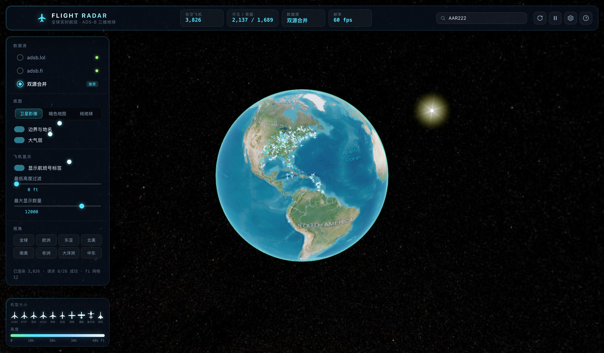

# Flight Radar

一个跑在 macOS 上的**全球实时航班雷达**：Cesium 三维地球 + 卫星影像底图 + 来自
[adsb.lol](https://adsb.lol/) 与 [adsb.fi](https://adsb.fi/) 的实时 ADS-B 数据。



**安装包 5.9 MB**（App 本体 11 MB）。外壳用系统自带的 WKWebView + 200 KB 的 Swift 可执行文件，
不含 Electron。

| | Electron 版 | 本项目（原生 WKWebView） |
|---|---|---|
| DMG | 160 MB | **5.9 MB** |
| 帧率 | 2–5 fps | **60 fps** |
| 启动 | 数秒 | 即时 |

---

## 功能

| 模块 | 说明 |
| --- | --- |
| 三维地球 | Cesium 1.146，真实椭球建模、大气散射、星空、惯性旋转/缩放 |
| 卫星地图 | Esri World Imagery 全球卫星影像（最高 19 级），另有暗色画布与纯地球模式 |
| 实时航班 | 全球一次拉取（adsb.lol，约 1 万架在空目标），adsb.fi 按网格补充高密度区域 |
| 按机型大小图标 | 10 种 FR24 风格剪影，按**真实翼展/机身比例**绘制：A380 明显比 CRJ 更宽更大，一眼可辨 |
| 航班信息 | 航班号、ICAO、注册号、机型、描述、高度、几何高度、地速、航向、垂直速度、应答机、分类、信号强度、距接收站距离 |
| 平滑动画 | 按速度与航向做时间外推，10 秒一帧的数据也能连续滑行 |
| 高度着色 | 低空绿 → 中空青 → 高空白，左下角有高度色带图例 |
| 搜索 | 顶栏搜索航班号 / ICAO / 注册号，回车直接飞到目标 |
| 跟随 | 单击看详情，双击锁定视角跟随（目标稳定居中） |
| 视角预设 | 全球、欧洲、东亚、北美、南美、非洲、大洋洲、中东 |
| 筛选 | 最低高度过滤、最大显示数量、隐藏地面目标 |

### 两个已修复的关键问题

**1. 飞机穿透地球、能看见背面目标**

旧实现给 billboard 设了 `disableDepthTestDistance: Infinity`，这等于**强制关闭 GPU 深度测试**，
于是地球背面的飞机被直接画到球面上。修复分两层：

* 不再设置该属性（默认 `undefined` = 正常深度测试），被地球挡住的像素自然不显示；
* 每帧用 `Cesium.EllipsoidalOccluder.isPointVisible()` 做地平线剔除，把位于地球背面的目标
  直接 `show = false`。既省渲染，也消除球体边缘的深度精度漏画。

顶栏「可见 / 背面」实时显示被剔除的数量，可自行验证。

**2. 图标大小不可辨**

旧版所有飞机共用一个圆形光点贴图。现在按 ADS-B 机型代码（`t` 字段）映射到 10 类机体，
每类按**真实尺寸**（米）绘制在等比画布上：

| 类别 | 代表机型 | 翼展 | 机身 |
| --- | --- | --- | --- |
| `a380` | A380 | 79.8 m | 72.7 m |
| `b747` | B747 | 64.4 m | 70.6 m |
| `widebody` | B777 / B787 / A350 | 64.8 m | 66.8 m |
| `a330` | A330 | 60.3 m | 58.8 m |
| `narrowbody` | B737 / A320 | 35.8 m | 39.5 m |
| `regional` | CRJ900 / E190 | 24.9 m | 36.4 m |
| `turboprop` | ATR72 / Q400 | 27.1 m | 27.2 m |
| `light` | C172 / SR22 | 11.0 m | 8.3 m |
| `heli` | H135 / AS350 | 10.2 m | 12.2 m |
| `fighter` | F-16 / F-35 | 10.0 m | 15.0 m |

同一比例尺下，A380 的画布是 188×174，CRJ 只有 62×86 —— 大小差异来自几何而非硬编码缩放。
图标为白色实心 + 深蓝黑描边，运行时按高度染色。

---

## 数据来源

* **adsb.lol** — `https://api.adsb.lol/v2/point/{lat}/{lon}/{dist}`
  支持任意半径，一次 `20000 NM` 即可拿到全球全量快照（约 1 万架飞机，6 MB）。限速约 60 次/分钟。
* **adsb.fi** — `https://opendata.adsb.fi/api/v2/lat/{lat}/lon/{lon}/dist/{dist}`
  单次半径上限 **250 NM**，因此按视野网格切块并发查询。

两种数据源在渲染层按 `hex`（ICAO 24 位地址）合并去重，同一架机以 adsb.fi 的新数据为准。

> 所有请求由 Electron 主进程发出（`net:fetch`），渲染层不做跨域请求；主进程只放行这几个
> ADS-B 域名，避免页面被当作任意代理。

---

## 运行

```bash
npm install              # 只装 cesium（用于生成运行时资源）
npm run runtime          # 裁剪并复制 Cesium 到 app/cesium，顺带预压缩 .gz
npm run assets           # 生成 10 类机型图标
npm run icon             # 生成 build/icon.icns
npm run swift            # 编译原生外壳 → native/bin/FlightRadar
npm run build            # 组装 .app 并打包 release/Flight Radar.dmg
npm run start            # 构建后直接打开
npm run smoke            # 冒烟自检：抓状态 + 截图后自动退出
```

## 目录结构

```
Flight Radar/
├── native/
│   ├── main.swift        原生外壳：AppKit 窗口 + WKWebView + 两个自定义协议
│   ├── Info.plist
│   └── bin/FlightRadar   编译产物（~180 KB）
├── app/
│   ├── renderer/
│   │   ├── index.html    HUD 结构
│   │   ├── styles.css    设计系统（暗色 + 青色霓虹）
│   │   ├── assets/planes/  10 类机型图标（脚本生成）
│   │   └── js/
│   │       ├── bridge.js   渲染层 ↔ 原生桥（数据走 radar:// 代理）
│   │       ├── util.js     格式化 / 地理 / 状态导出
│   │       ├── sources.js  ADS-B 拉取、网格、合并、过滤
│   │       ├── scene.js    Cesium 场景、图元、遮挡剔除、交互
│   │       └── ui.js       侧栏、详情、搜索、快捷键
│   └── cesium/           裁剪后的 Cesium 运行时（脚本生成）
├── scripts/
│   ├── prepare-runtime.mjs  裁剪 Cesium + 预压缩
│   ├── build-assets.mjs     按真实尺寸生成机型图标
│   ├── build-icon.mjs       生成 build/icon.icns
│   └── build-app.sh         组装 .app + 打包 DMG
└── release/Flight Radar.dmg
```

### 三个必须由原生侧解决的事

**1. 自定义协议（否则地球全黑）**
Cesium 需要 Web Worker 与 ES Module。`file://` 的 origin 是 `null`，内核拒绝 Worker，
影像瓦片解不出来。本项目注册了两个 scheme：

* `app://local/` —— 把 `app/` 当本地静态站点；命中 `.gz` 且客户端接受 gzip 时直接下发
  预压缩内容（`Cesium.js` 5.8 MB → 1.7 MB）
* `radar://fetch/?url=…` —— 页面用普通 `fetch` 取 ADS-B 数据，由原生 `URLSession` 出网，
  绕开 CORS；只放行 adsb.lol / adsb.fi 三个域名

**2. 窗口必须真正显示**
`WKWebView` 在不可见时不渲染。早期自检没显示窗口，导致帧循环停摆（`fps: 0`）、
遮挡剔除不执行、`takeSnapshot` 只拿到首帧。现在自检同样会显示窗口。

**3. CSP 要放行自定义 scheme**
`script-src` 必须含 `blob:`（Cesium 的 worker），`connect-src` 必须含 `radar:`，
否则数据请求会静默失败在 "Load failed"。

---

## 快捷键

| 键 | 功能 |
| --- | --- |
| `拖拽 / 滚轮 / 右键拖拽` | 旋转、缩放、倾斜地球 |
| `单击飞机` | 打开航班详情 |
| `双击飞机` | 锁定跟随 |
| `⌘F` 或 `/` | 聚焦搜索框 |
| `R` | 立即刷新 |
| `空格` | 暂停 / 恢复自动刷新 |
| `F` | 全屏 |
| `1` `2` `3` | 卫星 / 暗色 / 纯地球 |
| `Esc` | 取消选中 · 关闭弹层 |

---

## 打包

```bash
npm run build
```

产物：`release/Flight Radar.dmg`（5.9 MB，Apple Silicon，需 macOS 13+）。

体积构成：Cesium 运行时 11 MB（预压缩后实际下发 3.5 MB）→ DMG 用 UDZO + zlib level 9 压到 5.9 MB。
原生可执行文件 180 KB，其余是 HTML/CSS/JS 与图标。

应用未做代码签名，首次打开需在**系统设置 → 隐私与安全性**放行，或：

```bash
xattr -dr com.apple.quarantine "/Applications/Flight Radar.app"
```

---

## 声明

ADS-B 数据来自 adsb.lol / adsb.fi 的志愿者接收站网络，版权归各社区所有；卫星影像 © Esri。
本项目仅用于学习与个人观测，请控制刷新频率，遵守数据源的使用条款。
